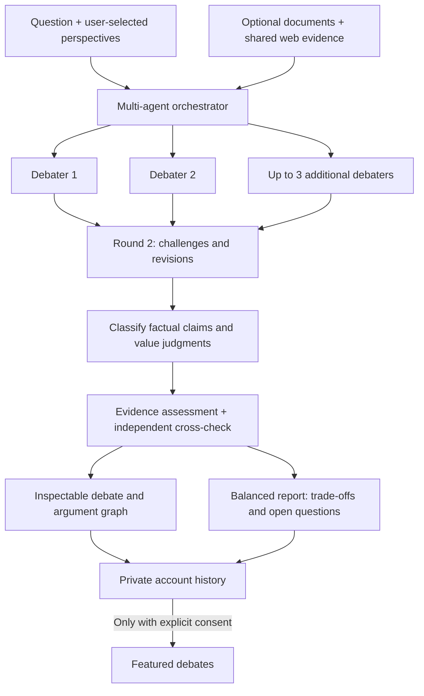

# Decision Atlas

### A multi-agent debate platform that makes arguments, evidence, and disagreements visible.

**[Explore the live app](https://decision-atlas-358533498865.us-central1.run.app/)**

Decision Atlas brings **2–5 AI perspectives** into a structured, two-round debate. Rather than returning a single opaque answer, it shows how different viewpoints argue, challenge one another, assess evidence, and revise their positions. A final balanced report brings the trade-offs and unresolved questions together without declaring a winner.

Built as an end-to-end AI/ML engineering project: model orchestration, evidence retrieval, structured generation, independent claim assessment, streamed results, authentication, and cloud deployment.

## What makes it multi-agent?

Each debater has a user-selected perspective and a separate generation context. The participants share the same question and evidence, but examine them through different priorities. After the opening round, each receives the same complete snapshot of earlier arguments and can challenge specific claims or revise a position.

The workflow also separates **claim classification, evidence verification, independent cross-checking, and report generation** into bounded stages. The application orchestrates these stages and makes their outputs inspectable.

Agents are logical roles; they do not all need a different underlying model. More agents or rounds are not assumed to improve accuracy. The purpose is to expose reasoning, competing priorities, and uncertainty for human review.

## Features

- **User-controlled participants:** choose 2–5 debaters, write their perspectives, or request editable AI suggestions for the topic.
- **Two visible rounds:** opening arguments followed by specific challenges and retained or revised positions. Every participant gets equal access to the previous round.
- **Optional web search:** switch it on when current evidence matters. With it off, the debate uses model knowledge and any documents supplied.
- **Document evidence:** add PDFs or pasted passages and inspect how the selected evidence relates to claims.
- **Transparent verification:** view supported, contradicted, insufficient-evidence, value-judgment, unverified, and requires-review labels with explanations. Verifier disagreements remain visible.
- **Interactive argument graph:** trace questions, claims, sources, and challenges through connected nodes.
- **Balanced reports:** read or export a 300–500 word brief that preserves disagreements and uncertainty rather than choosing a winner.
- **Personal accounts:** Google sign-in or email/password signup, login, password reset, and private **My debates** history for completed signed-in runs.
- **Unlisted sharing:** create a link from a completed debate or **My debates**, then copy it or use your device’s share sheet where supported. Anyone with the link can read it; creating a link does not add it to the gallery.
- **Featured debates:** independently publish a completed debate to the public gallery with separate consent. Trending order combines community likes and recency.
- **Desktop and mobile:** a responsive workspace, with navigation to the studio, featured collection, account, and private history.

Visitors receive **five demo debate starts**. The introductory example is clearly labeled as a hand-authored sample.

## Where it can be useful

| Use case | Example | What the platform helps examine |
| --- | --- | --- |
| **Policy exploration** | Should a city introduce congestion pricing? | Resident, transport, accessibility, business, and public-finance priorities; contested assumptions and evidence gaps. |
| **Institutional decisions** | Should universities require attendance? | Student, faculty, administrative, and accessibility perspectives without collapsing them into one score. |
| **Research and evidence review** | What do the supplied studies suggest about an intervention? | Which passages support a claim, which claims lack evidence, and where assessments disagree. |
| **Product and organizational planning** | Should a team adopt a four-day workweek? | Operational trade-offs, measurable assumptions, and questions worth investigating before a decision. |
| **Learning and discussion** | What makes a protein source “best”? | How nutrition, affordability, sustainability, and personal priorities lead to different answers. |

Decision Atlas supports discussion and investigation. Generated perspectives do not replace consultation with real stakeholders, and policy decisions still require domain expertise and review of full sources.

## Tech stack

| Layer | Technologies |
| --- | --- |
| Frontend | React, TypeScript, Vite, CSS, Lucide icons |
| Argument visualization | React Flow |
| Backend and validation | Python, FastAPI, Pydantic, Uvicorn |
| Multi-agent orchestration | Custom Python workflow, structured JSON generation, fixed round snapshots |
| Model access | Vercel AI Gateway with pinned model/provider routes |
| Search and documents | Shared Perplexity Search, PDF.js, bounded passage retrieval |
| Authentication | Google Identity Platform / Firebase Authentication, Firebase Admin SDK |
| Persistent storage | Google Cloud Firestore |
| Deployment and secrets | Docker, Google Cloud Run, Google Secret Manager |
| Validation and delivery | Pytest, TypeScript checks, GitHub Actions |

The frontend and FastAPI backend share one Cloud Run deployment. Vercel supplies model access; it does not host the frontend.

## Why these models?

The pool was chosen to balance affordable repeated calls, structured outputs, and useful behavior at different stages. Development included five-topic simulations, small claim fixtures, comparisons with other screened models, and hosted pipeline checks. These are practical engineering checks, not proof that this pool is universally best.

| Model | Role | Reason for selection |
| --- | --- | --- |
| **Qwen 3.7 Flash** (`alibaba/qwen3.7-flash`) | Perspective suggestions and most web-enabled arguments | Keeps short role-generation and repeated evidence-grounded drafting calls economical. All participants use the same retrieved evidence bundle. |
| **Qwen 3.8 27B** (`alibaba/qwen3.8-27b`) | Debate arguments with web search off | A screened dense-model option for the knowledge/document workflow. Observed provider capacity failures led to a bounded fallback rather than unlimited retries. |
| **Claude Haiku 5.5** (`anthropic/claude-haiku-5.5`) | One web-enabled participant; classification, verification, report generation and report review; temporary draft fallback | Handles the structured assessment and reporting stages used in development checks, and adds another model family to web debate drafts. Its failures and limitations are documented. |
| **GPT-OSS 20B** (`openai/gpt-oss-20b`) | Independent evidence cross-check | Adds a low-cost second assessment so disagreements can be surfaced instead of treating one verifier as authoritative. |
| **Perplexity Search** | One shared retrieval request in web mode | Supplies excerpts and original URLs to all debaters. It is the retrieval stage, not another debate participant. |

The gateway pins providers and enables only a bounded inexpensive fallback for temporary drafting failures. Participant count scales from 2 to 5; the platform does not hard-code three debaters. Model agreement is not a guarantee of truth.

## Evidence and report design

Web search runs **once per debate**, rather than once per agent. The application selects a bounded set of passages while retaining representation of supplied documents and web results. These are partial readings, not exhaustive literature reviews.

When evidence is available, separate models assess source-backed claims. Conflicting assessments become **requires review**. Without sources, empirical claims remain **unverified**; a missing citation does not turn an empirical statement into a value judgment.

The report summarizes evidence, priorities, challenges, revisions, and remaining gaps. A separate review checks direct recommendations and winner language. That review does not independently certify every report fact or guarantee neutrality.

## Accounts, history, and sharing

**Accounts are optional. Anyone can start a debate as a guest.** When signed in, completed debates are saved automatically in My debates. Accounts use Google sign-in or Google-managed email/password authentication; the application receives identity tokens and does not receive or store account passwords. Password reset and sign-out are included.

Saved debates stay private. Unlisted sharing and publishing to Featured are independent, explicit choices after reviewing the generated text. Featured copies exclude raw source passages and internal accounting, but generated arguments may still contain details from user inputs. Community popularity is not evidence quality or expert endorsement.

The demo retains up to 100 saved debates per account, with a bounded shared storage allocation. Guest runs are not attached retroactively. Hiding a saved debate removes it from the history list while retaining its private record. The admin can use **Delete from Featured** after signing in through Google with the configured `OWNER_GOOGLE_EMAIL`. Deleting removes the Featured publication while preserving the author’s private history and independently created share links. Shared snapshots use their own storage and URLs (`?share=…`); Featured views use `?debate=…`. A minimal moderation record prevents restoring the same removed Featured publication.

## Validation and results

Automated checks cover participant counts, equal round snapshots, structured outputs, evidence labels, shared retrieval, bounded fallback, verifier disagreement, persistent usage controls, authentication boundaries, private-history isolation, publication consent, and concurrent storage operations.

Recorded hosted smoke checks completed all three evidence modes:

| Mode | Participants / arguments | Report length |
| --- | --- | --- |
| Knowledge only | 2 / 4 | 316 words |
| Supplied document | 5 / 10 | 321 words |
| Web search | 3 / 6 | 328 words |

These are small functional examples, not accuracy benchmarks.

A single-call baseline was cheaper and faster in the development comparison. The demonstrated benefit of this system is **inspectability**, not proven superiority over a single agent. Failures and later fixes are retained in the [quality review](docs/quality-review.md) rather than omitted.

## Limitations

- Models can invent facts, misclassify claims, or agree on an incorrect assessment. Inspect important claims against full sources.
- Two rounds are a bounded design choice; more agents or rounds are not established to improve results.
- Provider failures can leave partial arguments without a completed report. The interface reports failures explicitly.
- Generated stakeholder roles are useful prompts, not representatives of real communities.
- Featured debates are voluntarily shared AI outputs; trending does not establish consensus or correctness.

For implementation detail, see the [architecture](docs/architecture.md), [quality review](docs/quality-review.md), and [deployment notes](docs/google-cloud.md).
