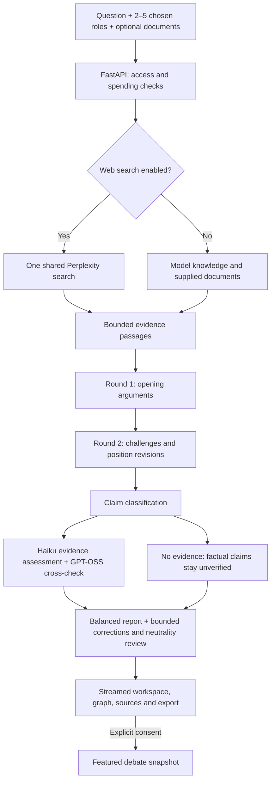

# Decision Atlas

### Make competing arguments—and their evidence—visible.

Decision Atlas turns a debatable question into an inspectable discussion between **2–5 perspectives you choose**. Follow two rounds of arguments, inspect the claims and sources behind them, and read a balanced report that preserves disagreements instead of declaring a winner.

**[Try the live app](https://decision-atlas-358533498865.us-central1.run.app/)** · [Architecture](docs/architecture.md) · [Quality review](docs/quality-review.md) · [Deployment guide](docs/google-cloud.md)

Built with **React, TypeScript, FastAPI, Google Cloud Run, Firestore, and the Vercel AI Gateway**. The frontend and backend share one Cloud Run deployment; Vercel provides model access, not frontend hosting.

## Why this project exists

A polished AI answer can hide which priorities it favors, which evidence it relies on, and where a reasonable person might disagree. Decision Atlas exposes those pieces as a discussion the reader can examine.

The project explores AI orchestration, evidence retrieval, structured generation, independent claim assessment, streaming interfaces, and persistent cost controls. Its demonstrated benefit is **inspectability**, not proven superiority over a single model. A single-call baseline was cheaper and faster in the small development comparison; [the quality review](docs/quality-review.md) records that result alongside pipeline failures and fixes.

## What you can do

- Enter a topic, choose 2–5 participants, and write their roles or request editable AI suggestions. Changing the topic clears previous roles. The introductory university example is a separate, clearly labeled sample.
- Keep **Search the web** off for conceptual questions or document-based discussion. Turn it on when current information matters; all perspectives share the same retrieved evidence.
- Add PDFs or pasted text, follow opening arguments and a second round of challenges, and inspect an argument graph.
- Open factual claims to see selected passages, evidence labels, and independent verifier explanations. Disagreements remain visible as **requires review**.
- Read or export a balanced **300–500 word report** covering evidence, trade-offs, changed positions, and unresolved questions. The intended output has no winner or policy recommendation.
- Explicitly share a completed debate in **Featured debates**. Sharing is optional; creating a debate does not publish it. Community votes help order the collection by popularity and recency.

The workspace adapts to desktop and mobile. Ordinary visitors see their available debate starts rather than internal model-cost accounting.

## Where it can be useful

| Use case | Example question | What a reader can examine |
| --- | --- | --- |
| Policy exploration | Should a city introduce congestion pricing? | Transport, resident, accessibility, business, and public-finance perspectives; contested assumptions and evidence gaps. |
| Institutional decisions | Should a university require class attendance? | Student, faculty, access, and administrative priorities without collapsing them into one score. |
| Research and evidence review | What do the supplied studies suggest about a proposed intervention? | Which selected passages support a claim, which claims lack evidence, and where assessments disagree. |
| Product and organizational planning | Should a team adopt a four-day workweek? | Competing operational priorities, measurable claims, and questions worth investigating before a decision. |
| Learning and discussion | What makes a protein source “best”? | How cost, nutrition, sustainability, and personal preferences produce different answers. |

These are aids for framing a discussion and identifying further work. Policy decisions require affected stakeholders, domain expertise, and review of full sources; generated perspectives do not represent real stakeholder consultation. The app does not provide professional medical, legal, or financial advice.

## How a debate works



Every participant in a round sees the same completed previous-round snapshot. Later speakers receive no extra same-round context because of execution order. Participants are **logical perspectives**, not necessarily different model families.

Search runs once per web-enabled debate, rather than once per participant. The app retains original result URLs and raw excerpts, then selects at most five passages totaling 6,500 characters. Documents and web results both remain represented when supplied together. These are partial readings, not exhaustive literature reviews.

Source-backed claims receive passage assessments from Haiku and a separate GPT-OSS model. Conflicting labels become a review case. Source-free empirical claims remain **model knowledge—unverified**. A separate claim-kind step distinguishes measurable effects from pure value priorities. Citation presence and model agreement do not establish truth.

## Why these models?

The pool was chosen for a small public demo: low per-run cost, structured output, useful stage-specific behavior, and bounded recovery from observed provider failures. Five-topic simulations, small claim fixtures, and hosted pipeline checks informed the choice. They do **not** establish that these are the best available models or that the pool outperforms stronger alternatives.

| Model pinned in the gateway | Role | Selection rationale |
| --- | --- | --- |
| `alibaba/qwen3.7-flash` via Alibaba | Perspective suggestions; most web-enabled arguments | A cheap option for short role suggestions and arguments grounded in a shared evidence bundle. This keeps repeated draft calls economical. |
| `alibaba/qwen3.8-27b` via RunInfra | Arguments with web search off | A separate dense-model drafting option used in the screened knowledge/document workflow. Its capacity failures motivated a bounded fallback rather than unlimited retries. |
| `anthropic/claude-haiku-5.5` via Anthropic | One web-enabled participant; claim classification, verification, report and report review; temporary draft fallback | Centralizes the structured assessment and report tasks in the model used for those development checks, and adds a different family to web debate drafts. Review failures remain documented; this is no guarantee of neutrality. |
| `openai/gpt-oss-20b` via DeepInfra | Independent source-assessment cross-check | Adds a low-cost second assessment whose disagreements can be surfaced, rather than silently treating one verifier as authoritative. Two models can still share an error. |
| Perplexity Search through the AI Gateway SDK | One shared retrieval request in web mode | Retrieves excerpts and original URLs for all participants; it is a search stage, not another debate participant. |

Web-on arguments use Qwen Flash plus one Haiku participant, scaled to the chosen participant count. Web-off arguments use the dense Qwen model. On temporary dense-provider capacity/rate-limit errors, a single fallback uses Haiku and the dense provider is cooled down for two minutes. Providers are pinned; arbitrary expensive fallbacks are disabled. Actual argument models remain inspectable.

Model IDs, provider routing, and accounting rates live in [gateway.py](backend/app/gateway.py). The checked-in rates are application assumptions, not a current pricing quotation; review them when changing providers or updating the pool.

## Access, privacy, and spending controls

Public visitors receive **five lifetime debate starts per network IP**. Suggestions do not consume a debate start, but are request-limited. A started debate consumes a use even if a provider later fails. Counters survive restarts and deployments.

IP allowances use salted hashes. The app does not identify hardware or establish a person's identity: shared Wi-Fi shares an allowance, and changing networks can bypass it. Hosting must validate the trusted proxy chain so a visitor cannot select a different address with a forged forwarding header.

The owner can open **Owner access** and authenticate with the server-configured `ATLAS_OWNER_TOKEN` to bypass the public start allowance and request-rate limits. Login creates a signed, HttpOnly session cookie lasting 12 hours; cloud cookies are also Secure. Owner access still obeys spending caps. Never embed the owner token in the frontend, a shared link, or Git.

The application enforces a **$1 daily AI/search budget, resetting at midnight UTC**, alongside the existing **$2 cumulative AI/search budget**. These apply across sessions and include owner activity. Each paid operation first reserves a conservative upper bound in the persistent ledger, then settles reported usage; unknown failures retain their reservation. A new call can be blocked before the displayed total reaches the cap if its reservation would exceed the remaining budget.

When a cap is reached, paid debate and suggestion requests stop; the site and previously featured debates remain available. This pauses model spending rather than taking the website offline. Reaching the cumulative cap requires an intentional owner budget change; the daily reset does not reset it.

These are **application AI/search controls**, not a cap on the Google Cloud bill. Hosting, Firestore, storage, logging, network traffic, and secrets have their own metered usage and free allowances. Provider pricing changes and billing discrepancies also require monitoring. The original $2 per 100 debates is a planning target, not a promise for arbitrary topics, participant counts, or corrections.

PDFs are parsed in the browser. Questions and selected passages are sent to configured AI/search providers when used. The usage ledger stores accounting and hashed counters. A sanitized completed snapshot is stored privately in one of 500 bounded draft slots to support optional publication. Its publication token expires after 24 hours; expired slots are overwritten on reuse. Only explicit consent makes a snapshot public. Raw document passage text and internal spending fields are excluded. Review the debate and publication notice before sharing: generated arguments and reports can still repeat information from your inputs. Cloud access logs are separate from the application ledger.

Only successfully completed server runs can be published, using an unguessable publication token valid for 24 hours and explicit consent. Public publishing accepts that token, not a browser-authored report. The collection is bounded to 200 retained featured debates, including posts hidden by the owner. Owners can hide a post from discovery and public access. Featured rankings are a demo discovery mechanism, not an endorsement or a representative public poll. Network-based voting controls reduce simple repeat voting but do not establish unique human voters.

## Run locally

Requires **Python 3.12+** and **Node.js 22+**. The Node runtime is also used by the shared search helper.

```bash
git clone https://github.com/dhanunjay1729/decision-atlas.git
cd decision-atlas
npm ci
npm run build
python -m venv .venv
.venv/bin/python -m pip install -r backend/requirements.txt
cp .env.example .env
# Privately set AI_GATEWAY_API_KEY in .env.
bash run_local.sh
```

Open [localhost:8000](http://127.0.0.1:8000). For a different port, run `DECISION_ATLAS_PORT=8003 bash run_local.sh`. FastAPI serves both the production frontend build and the API.

For frontend development, `npm run dev` uses the Vite server and proxies `/api` to port 8000. Keep the proxy in sync if you change the backend port.

Use the ignored `.env` file or server environment variables. Never put secrets in `VITE_` variables, tracked files, browser logs, or exported reports. Existing server environment variables take precedence over `.env`. See [.env.example](.env.example) for supported settings.

Local development uses SQLite. Retain the ledger file and its salt to retain counters and budgets. The Cloud Run deployment requires Firestore and refuses ephemeral SQLite. Changing a deployment should not recreate accounting state.

## API overview

| Endpoint | Purpose |
| --- | --- |
| `GET /api/status` | Provider readiness and pool label; no credentials. |
| `GET /api/allowance` | Network allowance, or authenticated owner access status. |
| `POST /api/prepare` | Editable role suggestions for `{question, participant_count}`; optional neutral question wording. |
| `POST /api/analyze` | Debate request with `question`, `perspectives`, optional document `sources`, and `include_web`; streams progress, sources, arguments, completion, or explicit errors through SSE. |
| `POST /api/estimate` | Deterministic internal planning estimate; does not call a model or search. |
| `POST /api/owner/login` | Authenticate `{token}` and create an owner session. |
| `POST /api/owner/logout` | Clear the owner session. |
| `GET /api/featured` | List public debates in trending order. |
| `POST /api/featured` | Publish an eligible completed run with `{publish_token, consent: true}`. |
| `GET /api/featured/{id}` | Open a public debate snapshot. |
| `POST /api/featured/{id}/like` | Record a network-limited vote. |
| `POST /api/featured/{id}/hide` | Owner-only moderation: hide a public post while retaining its snapshot privately. |

Clients may supply document text, not trusted web results or arbitrary model IDs. The server does not fetch user-supplied URLs. PDFs are limited to 5 MB / 30 pages each, combined text to 30,000 characters, and API POST bodies to 256 KB. Scanned PDFs require pasted text.

## Validation and honest results

```bash
PYTHONPATH=backend .venv/bin/python -m pytest backend/tests -q
npm run build
```

The test suite covers round snapshots, 2–5 roles, evidence labels, forged client sources, pinned providers, bounded fallback, verifier disagreement, shared search, persistent spending reservations, atomic IP counters, and request limits. New public features have focused tests for authentication, daily caps, and explicit publication.

Recorded hosted smoke checks completed all three evidence modes:

| Mode | Participants / arguments | Report words | Tracked AI/search cost |
| --- | --- | --- | --- |
| Knowledge only | 2 / 4 | 316 | $0.001503 |
| Fictional document | 5 / 10 | 321 | $0.005871 |
| Web search | 3 / 6 | 328 | $0.013156 |

Together with their perspective suggestions, those checks accounted for approximately **$0.0206**. This is a small functional sample, not a universal cost estimate or accuracy benchmark. The [tracked cloud summary](evaluation/cloud-live-summary.json) and [quality review](docs/quality-review.md) explain the inputs, failures, baseline limitations, and later fixes.

A deliberately paid, opt-in evaluation runner is available:

```bash
PYTHONPATH=backend .venv/bin/python scripts/evaluate.py \
  --live --max-usd .06 --name YOUR_NEW_RUN_NAME
```

It uses a separate persistent evaluation ledger, saves failures alongside successes, and refuses an existing run directory. Run it only with an approved research budget. No live evaluation is required to build or run offline tests.

## Deployment

The public app runs in **Google Cloud Run, us-central1**, with zero minimum instances and one configured maximum instance. Firestore persists counters, reservations, and opted-in featured content. Secret Manager supplies server credentials to a dedicated runtime service account; no service-account JSON key is needed.

A multi-stage Dockerfile builds the frontend and packages the Python API plus Node search helper. Credential files, local ledgers, and research output are excluded from the image. Updates preserve the same Firestore state and verified ingress settings.

See [Google Cloud deployment](docs/google-cloud.md) for provisioning, IAM, private validation, trusted proxy checks, and the production update procedure. Cloud Run free allowances are conditional; the service is not guaranteed to incur zero infrastructure charges.

## Limitations

- Two rounds are a deliberate bounded workflow. More agents or rounds are not established to improve accuracy.
- Models can invent claims, misclassify values, or agree on an incorrect evidence assessment. Partial excerpts can omit qualifications; inspect the full source.
- Report review checks direct advice and winner language. It does not independently certify every report fact or guarantee neutrality.
- A provider failure or failed report correction can leave partial arguments without a completed report. The app reports that failure explicitly rather than claiming success.
- Featured content is AI-generated and voluntarily published. Popularity is not evidence quality, consensus, or expert review.
- IP-based limits and voting controls are imperfect demo safeguards. A larger public launch needs stronger abuse controls and a publication/moderation policy.

## Project map

```text
frontend/                    React workspace and visualizations
backend/app/                 FastAPI, debate engine, retrieval and providers
backend/tests/               Offline regression tests
backend/search.mjs           Shared Perplexity retrieval helper
scripts/                     Evaluation and GCP deployment preparation
evaluation/                  Small fixtures and recorded check summaries
docs/                        Architecture, quality review and deployment notes
```
