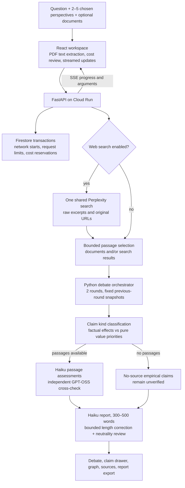

# Decision Atlas architecture

Participants are logical roles, not necessarily different model families. Users choose 2–5 roles; multiple roles may use the same pinned model. Every participant within a round receives the same completed previous-round snapshot. This avoids granting later speakers extra same-round context solely because of execution order.

The gateway pins inexpensive providers and models. Qwen 3.8 27B handles web-off drafts with a bounded Haiku fallback on temporary capacity errors; web-on drafts mix Qwen Flash with one Haiku perspective. Haiku classifies claim kinds and assesses evidence. GPT-OSS 20B cross-checks passage assessments independently. Label disagreements become explicit review cases rather than confident evidence labels.

The report reviewer checks direct advice and winner language in the literal report, allowing attributed participant positions. It does not independently certify all report facts. The pipeline can reject a result after bounded corrections instead of claiming a completed analysis. Model agreement, citation presence and structured-output validity are not guarantees of factual correctness.

Cloud Run uses its attached service account to access Firestore and one Secret Manager secret. Browser code receives neither cloud credentials nor the model key. Uploaded PDFs are parsed in the browser; questions and selected text passages are sent to configured AI/search providers when analysis runs. Firestore persists usage and spending records, not full debate histories or documents. Cloud request logs are separate from the app ledger.

See [quality review](quality-review.md) for the baseline comparison and its limits, and [Google Cloud deployment](google-cloud.md) for runtime settings and validation details.
